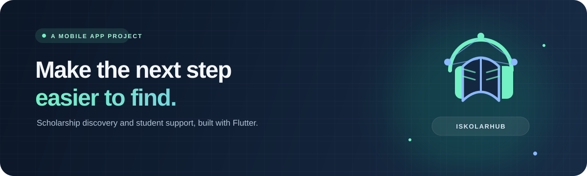

  

  
  
  

<h1 align="center">Hi, I'm Lloyd Andrei Garcia.</h1>

  I'm a Flutter developer building mobile software that turns complicated journeys into clearer next steps.
   
  Right now, that idea is <strong>IskolarHub</strong> — a scholarship discovery and student-support app.

  <a href="https://lloydgarcia0923320623-create.github.io/iskolarhub/"><strong>Visit my interactive portfolio →</strong></a>
  &nbsp; · &nbsp;
  <a href="https://github.com/lloydgarcia0923320623-create/iskolarhub"><strong>Explore IskolarHub →</strong></a>
  &nbsp; · &nbsp;
  <a href="https://github.com/lloydgarcia0923320623-create/iskolarhub#run">Run it locally</a>
  &nbsp; · &nbsp;
  <a href="https://github.com/lloydgarcia0923320623-create">More on GitHub</a>

 

## The idea

Finding a scholarship is only the start. Students also need to understand the
requirements, keep track of documents, and know where to verify the details.
**IskolarHub brings those steps together in one mobile experience.**

| 🔎 Discover | ✅ Stay organized | 📴 Keep going |
|:--|:--|:--|
| Browse scholarship records and compare structured criteria with a student profile. | Save opportunities, track checklist items, and review application deadlines. | Revisit cached information and personal checklist data when offline. |

### A closer look

- **Thoughtful matching:** preliminary, rule-based comparisons for recorded
  academic, course, year-level, and household-income criteria.
- **Useful follow-through:** saved-scholarship checklists, self-reported
  application status, and reminders where the device allows them.
- **Guidance with boundaries:** in-app references and retrieval-based answers
  grounded in the app's stored scholarship information and document guide.
- **Trust-aware design:** student reports can be reviewed by an authorized
  administrator; verification details help readers check source information.

> **Important:** a match is a starting point, not an eligibility decision or
> promise of an award. Students should confirm current requirements with the
> scholarship provider and apply through its official channel.

## Built with

  
  
  
  

| Layer | Project choices |
|:--|:--|
| Mobile app | Flutter and Dart |
| Accounts and shared records | Firebase Authentication and Cloud Firestore |
| On-device persistence | SQLite and shared preferences |
| AI-assisted guidance | Firebase AI Logic with retrieved in-app material |

## What this project explores

**Offline-aware data · rule-based matching · secure role boundaries ·
student-centered checklists · grounded AI guidance**

I care about making the useful path feel clear—and making limitations just as
clear as features.

## Take a look

| Project | What you'll find |
|:--|:--|
| [**IskolarHub**](https://github.com/lloydgarcia0923320623-create/iskolarhub) | The Flutter app, implementation details, setup instructions, and project limitations. |
| [**Source code**](https://github.com/lloydgarcia0923320623-create/iskolarhub/tree/main/lib) | App screens, scholarship models, matching, persistence, and guidance services. |

  Made with care, Flutter, and the belief that good tools can make opportunity easier to navigate.

